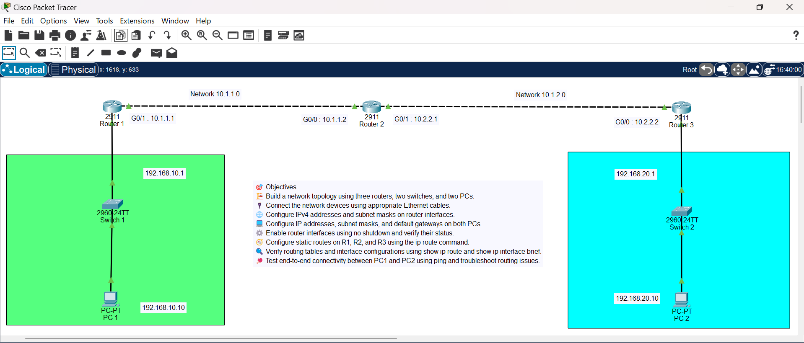
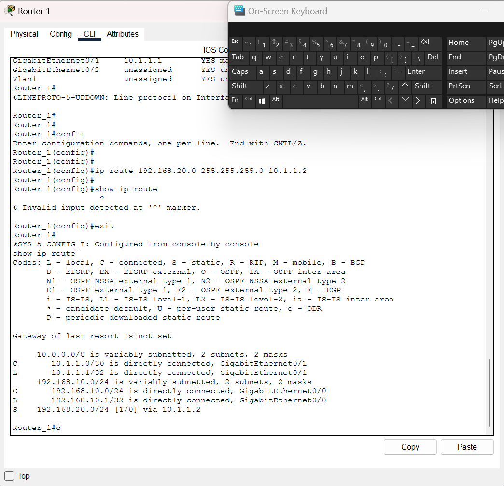
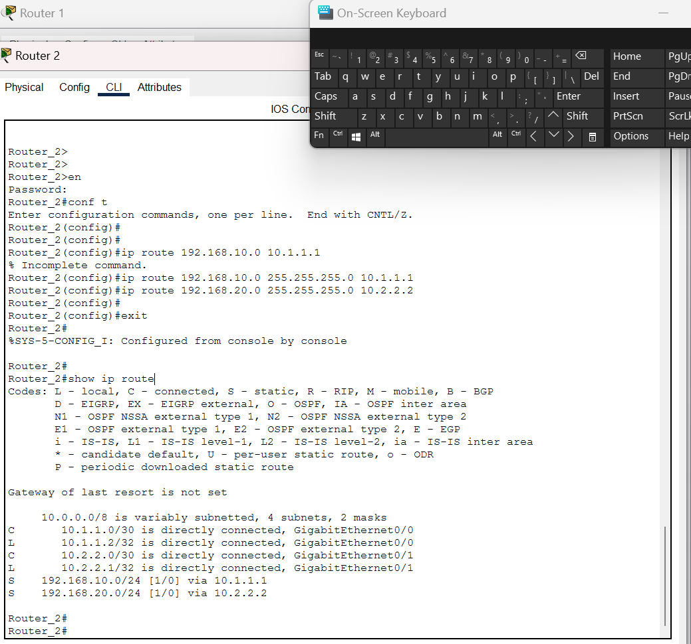
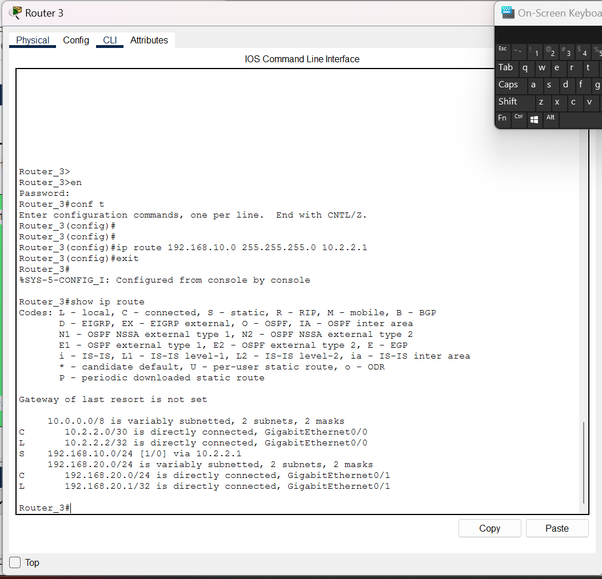
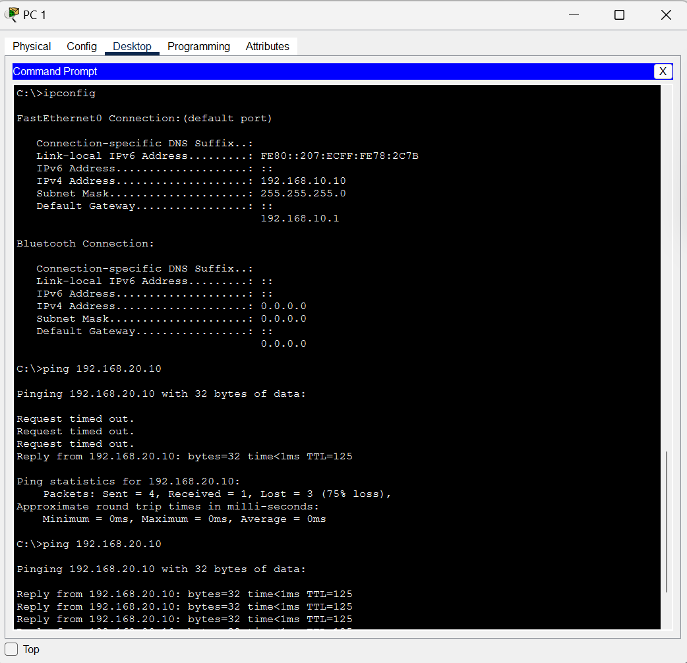
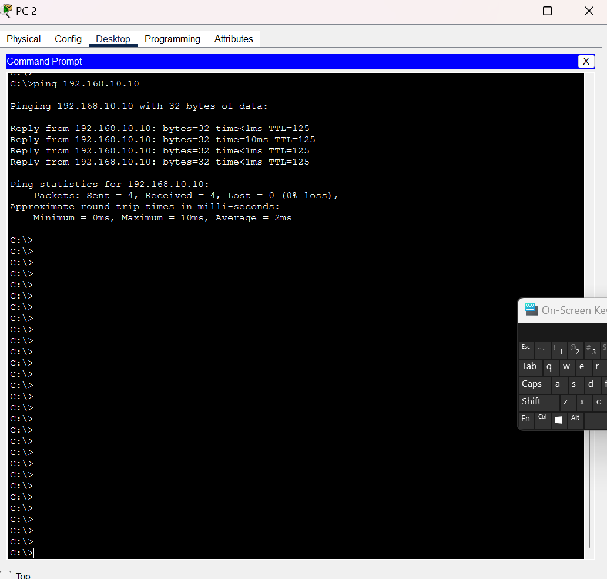

# 🌐 Lab 04 — Static Routing with Three Routers

## 🎯 Objective

Build a routed network in Cisco Packet Tracer using three routers, two switches, and two PCs. Configure IPv4 addressing on the router interfaces and end devices, create static routes on R1, R2, and R3, and verify end-to-end connectivity between PC1 and PC2. The lab demonstrates directly connected routes, static routes, next-hop addresses, subnet masks, routing-table interpretation, and return-path troubleshooting.

## 🗺️ Topology

```text
PC1
192.168.10.10/24
Gateway: 192.168.10.1
   |
 Switch 1
   |
R1 G0/0: 192.168.10.1/24
R1 G0/1: 10.1.1.1/30
   |
   | Network: 10.1.1.0/30
   |
R2 G0/0: 10.1.1.2/30
R2 G0/1: 10.2.2.1/30
   |
   | Network: 10.2.2.0/30
   |
R3 G0/0: 10.2.2.2/30
R3 G0/1: 192.168.20.1/24
   |
 Switch 2
   |
PC2
192.168.20.10/24
Gateway: 192.168.20.1
```

### 📸 Screenshots

<!-- Full Packet Tracer topology -->


<!-- R1 CLI showing `show ip route` -->


<!-- R2 CLI showing `show ip route` -->


<!-- R3 CLI showing `show ip route` -->


<!-- PC1 Command Prompt showing a successful ping to PC2 -->


<!-- PC2 Command Prompt showing a successful ping to PC1 -->



## 🧰 Devices

- 🔀 3 × Cisco 2911 routers
- 🔀 2 × Cisco 2960 switches
- 💻 2 × PCs
- 🔗 Copper Ethernet cables
- 💻 Cisco Packet Tracer

## 🏷️ IP Addressing

| Device | Interface | IP Address | Subnet Mask | Purpose |
|---|---|---|---|---|
| R1 | G0/0 | 192.168.10.1 | 255.255.255.0 | PC1 LAN gateway |
| R1 | G0/1 | 10.1.1.1 | 255.255.255.252 | R1–R2 link |
| R2 | G0/0 | 10.1.1.2 | 255.255.255.252 | R1–R2 link |
| R2 | G0/1 | 10.2.2.1 | 255.255.255.252 | R2–R3 link |
| R3 | G0/0 | 10.2.2.2 | 255.255.255.252 | R2–R3 link |
| R3 | G0/1 | 192.168.20.1 | 255.255.255.0 | PC2 LAN gateway |
| PC1 | NIC | 192.168.10.10 | 255.255.255.0 | End device |
| PC2 | NIC | 192.168.20.10 | 255.255.255.0 | End device |

**Important:** The interface names above are an example consistent with this addressing plan. If your actual Packet Tracer cabling uses different ports, apply the addresses to the interfaces that are physically connected to the corresponding networks.

## 🧭 Network Design

- LAN 1: `192.168.10.0/24`
- R1–R2 transit network: `10.1.1.0/30`
- R2–R3 transit network: `10.2.2.0/30`
- LAN 2: `192.168.20.0/24`

A `/30` subnet has four total IPv4 addresses and two conventional usable host addresses, which fits a point-to-point router link. A `/24` is used for each LAN in this lab.

## ⚙️ Implementation

1. 🧩 Added three routers, two switches, and two PCs in Packet Tracer.
2. 🔌 Connected each PC to its LAN switch and each LAN switch to its edge router.
3. 🔗 Connected R1 to R2 and R2 to R3.
4. 🔢 Assigned IPv4 addresses and subnet masks to router interfaces.
5. 🟢 Enabled the router interfaces with `no shutdown`.
6. 💻 Configured the IPv4 address, subnet mask, and default gateway on each PC.
7. 🧭 Added static routes for remote LANs on R1, R2, and R3.
8. 🔍 Verified interface status and routing tables.
9. 🏓 Tested end-to-end connectivity with ICMP ping.
10. 💾 Saved router configurations.

## 🔢 Router Interface Configuration

The commands below assume these interface mappings: R1 G0/0 connects to LAN 1 and G0/1 connects to R2; R2 G0/0 connects to R1 and G0/1 connects to R3; R3 G0/0 connects to R2 and G0/1 connects to LAN 2. Adjust the interface numbers if your topology differs.

### R1

```cisco
enable
configure terminal
hostname R1

interface gigabitEthernet0/0
 description LAN_1_to_Switch1
 ip address 192.168.10.1 255.255.255.0
 no shutdown
 exit

interface gigabitEthernet0/1
 description Link_to_R2
 ip address 10.1.1.1 255.255.255.252
 no shutdown
 exit
```

### R2

```cisco
enable
configure terminal
hostname R2

interface gigabitEthernet0/0
 description Link_to_R1
 ip address 10.1.1.2 255.255.255.252
 no shutdown
 exit

interface gigabitEthernet0/1
 description Link_to_R3
 ip address 10.2.2.1 255.255.255.252
 no shutdown
 exit
```

### R3

```cisco
enable
configure terminal
hostname R3

interface gigabitEthernet0/0
 description Link_to_R2
 ip address 10.2.2.2 255.255.255.252
 no shutdown
 exit

interface gigabitEthernet0/1
 description LAN_2_to_Switch2
 ip address 192.168.20.1 255.255.255.0
 no shutdown
 exit
```

## 🧭 Static Route Configuration

A static route tells a router how to reach a destination network that is not directly connected. The command format is:

```cisco
ip route <destination-network> <destination-mask> <next-hop-ip>
```

### R1 — Route to LAN 2

```cisco
R1(config)# ip route 192.168.20.0 255.255.255.0 10.1.1.2
```

R1 forwards packets for `192.168.20.0/24` to R2 at `10.1.1.2`.

### R2 — Routes to both LANs

```cisco
R2(config)# ip route 192.168.10.0 255.255.255.0 10.1.1.1
R2(config)# ip route 192.168.20.0 255.255.255.0 10.2.2.2
```

R2 forwards traffic for LAN 1 to R1 and traffic for LAN 2 to R3.

### R3 — Route to LAN 1

```cisco
R3(config)# ip route 192.168.10.0 255.255.255.0 10.2.2.1
```

R3 forwards packets for `192.168.10.0/24` to R2 at `10.2.2.1`.

## 🖥️ PC Configuration

### PC1

- IP address: `192.168.10.10`
- Subnet mask: `255.255.255.0`
- Default gateway: `192.168.10.1`

### PC2

- IP address: `192.168.20.10`
- Subnet mask: `255.255.255.0`
- Default gateway: `192.168.20.1`

The default gateway is the router interface a PC uses when the destination is outside its own subnet.

## 🔍 Verification

Run these commands on each router:

```cisco
show ip interface brief
show ip route
show running-config
```

Expected routing-table concepts:

- `C` — directly connected network
- `L` — the router's own interface address, usually shown as `/32`
- `S` — manually configured static route

Expected static routes:

| Router | Destination | Next hop |
|---|---|---|
| R1 | `192.168.20.0/24` | `10.1.1.2` |
| R2 | `192.168.10.0/24` | `10.1.1.1` |
| R2 | `192.168.20.0/24` | `10.2.2.2` |
| R3 | `192.168.10.0/24` | `10.2.2.1` |

Exact output formatting varies by IOS version and interface names. A static route will only be useful if its next hop is reachable and the relevant interfaces are operational.

## 🏓 Connectivity Test

First test directly connected neighbors from the routers:

```cisco
R1# ping 10.1.1.2
R2# ping 10.2.2.2
```

Then, from PC1's Command Prompt:

```text
ping 192.168.10.1
ping 192.168.20.10
```

From PC2:

```text
ping 192.168.20.1
ping 192.168.10.10
```

A successful ping typically reports replies and `0% loss`. The first ping can occasionally time out while ARP resolves an address; repeat the test before diagnosing a persistent failure.

## 💾 Save Configuration

On each router:

```cisco
copy running-config startup-config
```

This saves the current configuration so it can be loaded after a restart.

## 🛠️ Troubleshooting

### Interface is administratively down

```cisco
show ip interface brief
configure terminal
interface gigabitEthernet0/1
no shutdown
```

Use the actual interface that is down. `administratively down` usually means the interface has been disabled with `shutdown`.

### Static route is missing

```cisco
show ip route
show running-config
```

Confirm the destination network, destination mask, and next-hop IP. Also verify that the next hop is reachable through an active connected network.

### PC1 cannot ping PC2

Check the following in order:

- PC1 IP address, mask, and gateway
- PC2 IP address, mask, and gateway
- Router interface status and addressing
- Static route on R1 toward `192.168.20.0/24`
- Static routes on R2 toward both LANs
- Static route on R3 toward `192.168.10.0/24`
- Physical cabling and switch connections

### One-way communication

Static routing must support both the forward and return paths. If PC1's packet reaches PC2 but R3 has no route to `192.168.10.0/24`, the reply may fail.

## 📚 Key Concepts Learned

- IPv4 addressing and subnet masks
- `/24` LANs and `/30` point-to-point links
- Directly connected and local routes
- Static routing with `ip route`
- Destination network versus next-hop address
- Routing-table codes: `C`, `L`, and `S`
- PC default gateways
- Forward and return paths
- ICMP ping verification
- Troubleshooting missing routes and interface states
- Saving configurations

## 🏆 Skills Practiced

- Building a multi-router topology in Packet Tracer
- Configuring router interfaces
- Planning an IPv4 addressing scheme
- Configuring static routes on three routers
- Reading and interpreting `show ip route`
- Testing end-to-end connectivity
- Diagnosing routing and addressing problems
- Saving network device configurations
